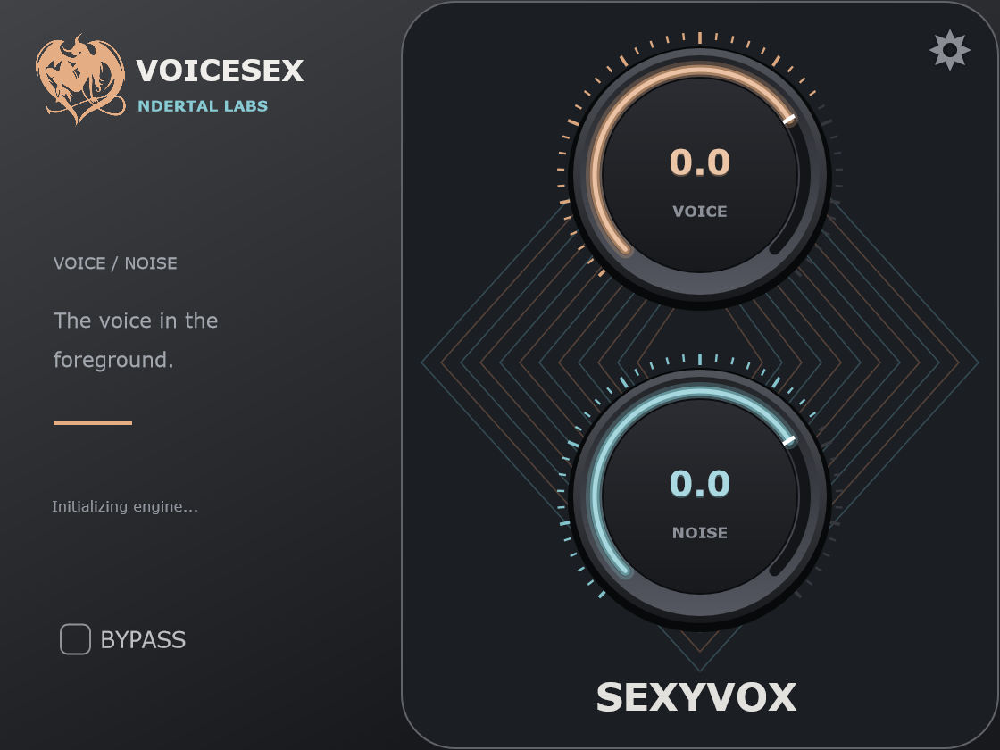

<div align="center">

# VOICESEX — Real-time AI Vocal Denoiser & Separator

[](https://github.com/neandertalzinhozinho/VOICESEX---Denoiser)
[](https://github.com/neandertalzinhozinho/VOICESEX---Denoiser)
[](https://github.com/neandertalzinhozinho/VOICESEX---Denoiser)

**Engenharia reversa open-source de famoso plugin de audio para remocao de ruido e separacao vocal em tempo real.**

<br/>



<br/>
<br/>

</div>

---

## Overview

**VOICESEX** is an open-source, ultra-low-latency VST3 audio plugin developed by **NDERTAL LABS**. Powered by deep neural networks running on ONNX Runtime CPU inference, it delivers clean vocal isolation and transparent ambient noise attenuation with zero perceptual distortion and pristine spectral reconstruction.

### Key Features

- **Dual-Knob Precision Control:**
  - **VOICE:** Dial in the exact vocal presence and dynamic body from -50 dB up to +20 dB.
  - **NOISE:** Retain or eliminate background acoustic ambience with organic phase transition.
- **Ultra-Low Latency Architecture:**
  - **48.0 kHz Native:** Deterministic pipeline running at **2048 samples (42.6 ms)** with 0 underruns on multi-threaded audio engines.
  - **44.1 kHz Resampling:** High-precision, zero-allocation cubic Lagrange interpolation maintaining sub-sample phase accuracy (**1943 samples / 44.0 ms**).
- **Bit-Perfect Complementarity:**
  - Strict preservation of the acoustic sum: `Voice + Noise ≈ Input` with mathematical precision (< 10⁻⁸ reconstruction error).
- **Modern Dark UI:**
  - Clean vector aesthetics with subtle neon depth, brushed metallic bezels, and instantaneous DAW parameter recall.

---

## Installation

1. Download the latest **`VOICESEX.vst3`** bundle from the Releases section.
2. Copy the **`VOICESEX.vst3`** folder to your system's VST3 directory:
   ```text
   C:\Program Files\Common Files\VST3\VOICESEX.vst3
   ```
3. Open your DAW (FL Studio, Ableton Live, Reaper, Cubase, Studio One, etc.).
4. Rescan plugins — **VOICESEX** will appear under **NDERTAL LABS** or the Effects category.

---

## Build from Source

### Prerequisites
- Windows 10/11 x64
- Visual Studio 2022 (MSVC C++17)
- CMake 3.22+

### Compile
```powershell
# Clone the repository
git clone https://github.com/neandertalzinhozinho/VOICESEX---Denoiser.git
cd VOICESEX---Denoiser

# Configure CMake
cmake -B native/sexyvox/out -S native/sexyvox -G "Visual Studio 17 2022" -A x64

# Build Release
cmake --build native/sexyvox/out --config Release --target VOICESEX_VST3
```

---

## Support & Community

- **Issues & Bug Reports:** [GitHub Issue Tracker](https://github.com/neandertalzinhozinho/VOICESEX---Denoiser/issues)
- **Author & Updates:** [@neandertalzinhozinho](https://github.com/neandertalzinhozinho)

*Developed with passion by **NDERTAL LABS**.*